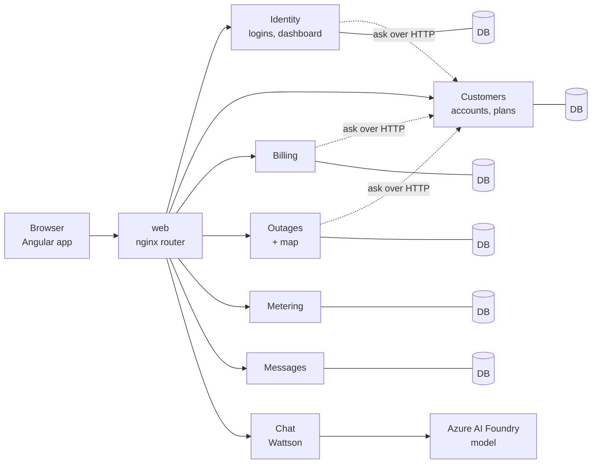

# Thornton Energy

A customer portal and operations back office for **Thornton Energy Inc.**, a fictional electric utility in central New Jersey. Customers pay bills, track usage, compare rate plans and report outages. Admins manage accounts, billing and the outage queue, with a live KPI dashboard and an audit trail.

**This version (Project 3)** takes the original single-API app and runs it as **six small services plus a chat assistant**, each in its own container, on **Kubernetes in Azure**.

## Try it

| | |
|---|---|
| Website | http://thornton-energy.centralus.cloudapp.azure.com |
| Chat | Click the little light bulb in the bottom-right corner |

The cluster is switched off between demos to save money, so the site may be offline. Ask the team to start it.

| Role | Email | Password | Good for |
|---|---|---|---|
| Customer | `jane@example.com` | `jane123` | Unpaid bill, active outage, usage history |
| Customer | `john@example.com` | `john123` | Time-of-Use plan |
| Customer | `maria@example.com` | `maria123` | Fully paid account |
| Admin | `support@thornenergy.com` | `admin123` | Every admin page |

Demo accounts with demo data only.

## How it fits together



The browser only talks to the website. The website's nginx sends each URL to the one service that owns it. Every service has **its own database** (six databases on one SQL Server), checks the login token itself, and asks other services over HTTP when it needs their data.

| Service | Owns | URLs |
|---|---|---|
| Identity | Logins, tokens, admin dashboard | `/api/auth` `/api/admin` |
| Customers | Customers and rate plans | `/api/customers` `/api/ratePlans` |
| Billing | Bills and billing numbers | `/api/bills` |
| Outages | Outage reports and the map | `/api/outages` |
| Metering | Meters and readings | `/api/meters` `/api/meterReadings` |
| Messages | Contact-form messages | `/api/messages` |
| Chat | The assistant (no database) | `/api/chat` |

Details: [docs/ARCHITECTURE.md](docs/ARCHITECTURE.md).

## Meet Wattson

Wattson is the chat assistant. It behaves differently depending on who is asking:

- **Visitors** get a general helper: rate plans, how bills work, energy-saving tips, outage safety.
- **Signed-in customers** get a personal one. It greets them by name and knows their plan, meters, bills and outages. It can file an outage report after the customer clicks **Confirm**.

The AI is never the security guard. Wattson can only call the services with the customer's **own login**, so the services' own rules still stop anyone from seeing someone else's data. It cannot take payments or change accounts. Setup and rules: [docs/CHAT-SETUP.md](docs/CHAT-SETUP.md).

## Run it on your computer

You need Docker Desktop.

1. Copy `.env.example` to `.env` and fill in `SQL_PASSWORD` and `JWT_KEY`. For chat, also set the three `FOUNDRY_` values (leave them empty and the site still works, just without chat). `.env` is never committed.
2. Start everything:
   ```powershell
   docker compose up --build
   ```
3. Open http://localhost:4200. Databases are created and filled with demo data on first start.

To use the published images instead of building, run `docker compose pull` and then `docker compose up -d --no-build`. Ports and Swagger can be changed in `.env` (see the comments in `.env.example`). SSMS: connect to `localhost,14330` as `sa`.

## Run it on Kubernetes (AKS)

The `k8s/` folder holds one set of files for the whole app, with image lists for local Docker Desktop and for AKS. See [k8s/README.md](k8s/README.md). In short: start the cluster, create the secret from `.env`, then `kubectl apply -k k8s/aks`.

## Security at a glance

- **Secure by default:** every endpoint needs a signed-in user unless it says otherwise. Public ones are login, register, the rate plans and the contact form.
- **Roles and ownership:** admin pages need the admin role, and a customer asking for someone else's data gets a 403.
- **Services trust tokens, not the network:** each service checks the signed token itself. Service-to-service endpoints are blocked at the website's router.
- **Server-side rules:** bills are priced and dated on the server, never trusted from the browser.
- **Secrets stay out of git:** `.env` locally, a Kubernetes secret in the cluster.
- **Chat guardrails:** fixed list of tools, confirmation before any change, rate limits, and no account access for visitors.

## Testing

```powershell
dotnet test server/ThorntonEnergy.slnx      # 129 tests across the services
cd client; npx ng test --watch=false        # 78 tests
```

Each service has its own test project that runs without Docker or the other services.

## What's next

Still to do or worth doing: **HTTPS**, **Azure Key Vault**, **automatic tests and image builds (CI)**, database backups, and a few smaller ideas. The full list, including how to turn on Swagger and how to check SSMS on the cluster, is in [docs/NEXT-STEPS.md](docs/NEXT-STEPS.md).

## Team

Isaiah Thornton, Sebastian Inoa, Michael Gerges and Chris Merlini built this together as a four-person team: splitting the app into services, writing the Docker and Kubernetes setup, publishing the images, and building the chat assistant.

## Tech stack

Angular 22 · ASP.NET Core (.NET 10) · Entity Framework Core · SQL Server · Docker and Docker Compose · Kubernetes on Azure (AKS) · Azure AI Foundry · xUnit and Vitest

## More documentation

- [docs/ARCHITECTURE.md](docs/ARCHITECTURE.md): services, how they trust each other, data, Kubernetes layout
- [docs/CHAT-SETUP.md](docs/CHAT-SETUP.md): the assistant's setup, limits and tools
- [docs/DEMO.md](docs/DEMO.md): the demo script
- [docs/NEXT-STEPS.md](docs/NEXT-STEPS.md): what is left and what to improve
- [docs/BRD.md](docs/BRD.md): business requirements
- [docs/AI-LOG.md](docs/AI-LOG.md): how AI was used, and what was checked
