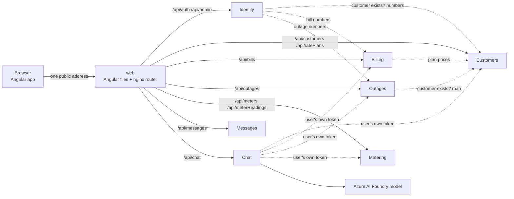
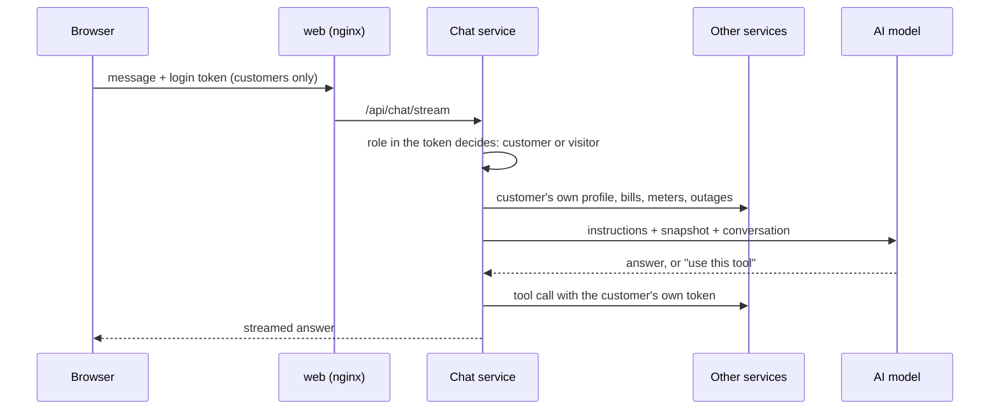

# Architecture

Thornton Energy started as one ASP.NET API with one database. It now runs as six small services plus a chat assistant, behind one router, on Kubernetes. The Angular app calls the same URLs as before.

## 1. The big picture

Solid arrows are browser traffic. Dotted arrows are calls one service makes to another.

## 2. Who owns what

| Service | Folder (in `server/`) | Owns | Database | Port in Docker |
|---|---|---|---|---|
| Identity | `ThorntonEnergy.Api` | Users, tokens, admin dashboard, old audit history | ThorntonEnergy | 8080 |
| Customers | `ThorntonEnergy.Customers.Api` | Customers, rate plans, customer audit log | ThorntonCustomers | 8085 |
| Billing | `ThorntonEnergy.Billing.Api` | Bills, bill audit log, billing numbers | ThorntonBilling | 8083 |
| Outages | `ThorntonEnergy.Outages.Api` | Outage reports, outage map, outage audit log | ThorntonOutages | 8084 |
| Metering | `ThorntonEnergy.Metering.Api` | Meters and readings | ThorntonMetering | 8082 |
| Messages | `ThorntonEnergy.Messages.Api` | Contact-form messages | ThorntonMessages | 8081 |
| Chat | `ThorntonEnergy.Chat.Api` | Nothing stored | none | internal only |

`ThorntonEnergy.Shared` is a class library, not a service. Every service uses it for token checks, error handling, health checks and the HTTP client for calling other services. Each service keeps its own copy of the classes it needs, so changing one never forces the others to change.

## 3. How services trust each other

- **One signing key.** Identity signs login tokens. Every service checks the signature, issuer, audience and expiry itself with the same key, so nobody trusts a request just because it came from inside the network.
- **The user's token is passed along.** When a signed-in person causes a call between services (for example the admin dashboard), their own token travels with it, so the called service applies its own rules.
- **A service token for login.** Nobody is signed in yet at login, so Identity signs a short-lived token with the role `Service`. Only the internal Customers endpoints accept it.
- **Internal endpoints are not public.** `/api/internal/` is answered with 404 by the router and refused by the token check as well.
- **Failures are clean.** A failed call between services returns a readable 503, not a crash. Admins can still sign in if Customers is down.

## 4. Data

Each service owns its tables, and no service reads another's. Links between services are plain ids with an index, not foreign keys. The owning service checks them, either from the caller's token (ownership) or by asking the other service (existence). Customers and rate plans live together, so they keep a real foreign key.

All six databases sit on one SQL Server container with one disk. Each service creates and updates its own database when it starts (EF Core migrations) and fills it with demo data if it is empty. SQL triggers write audit entries, and a view and stored procedure feed the dashboard numbers.

## 5. The chat assistant

- **Customers** get a personal prompt with a snapshot of their own account. **Visitors and admins** get a general prompt and can only read the public rate plans.
- Reporting an outage pauses for a Confirm click. The service files it only if the confirmed text matches, and only once.
- Limits: 15 requests a minute per customer, one shared pool of 20 a minute for visitors, short conversations, capped replies and capped tool results. Details are in [CHAT-SETUP.md](CHAT-SETUP.md).

## 6. Kubernetes layout

| Piece | Copies | Reached at |
|---|---|---|
| db (SQL Server and an 8 GB disk) | 1 | `db:1433`, inside the cluster only |
| api, customers, billing, outages, metering, messages, chat | 1 each (Customers scaled to 2 after first start) | `<name>:8080`, inside the cluster only |
| web | 2 | the only public address (a load balancer with an Azure DNS name) |

Service names match the Docker Compose names, so the router config and every connection string work in both places. Each service has `/health/live` (is it running?) and `/health/ready` (can it reach its own database?) for Kubernetes. Secrets come from a Kubernetes secret created from a local file, never from git. Files are in `k8s/`, with image lists for local Docker Desktop and for AKS.

## 7. Repository layout

| Path | What is in it |
|---|---|
| `client/` | Angular app, `nginx.conf` (the router) and its Dockerfile |
| `server/` | One folder per service, each with a `Dockerfile`, plus `ThorntonEnergy.Shared` and a test project per service |
| `k8s/` | Kubernetes files: `base/`, `local/`, `aks/` |
| `docker-compose.yml` | Runs everything on one computer |
| `docs/` | This documentation |
| `.env.example` | The settings a person must provide (copy to `.env`) |
